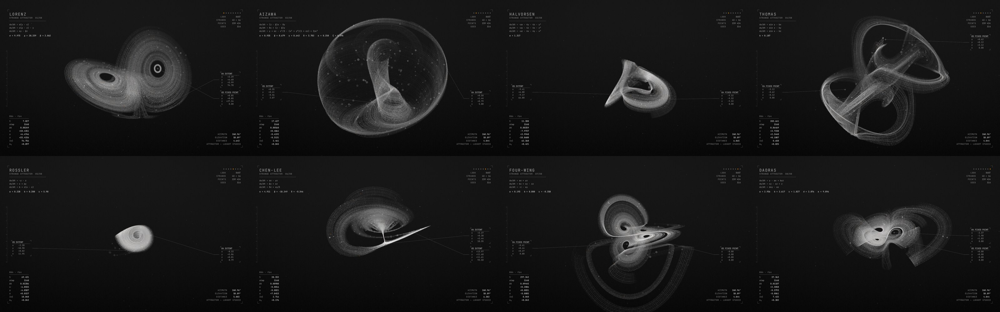
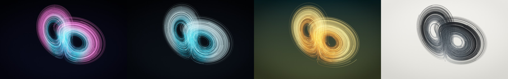

# Attractor

Strange attractors as a **live wallpaper** and a **screensaver** for [Omarchy](https://omarchy.org), by lAvArt Studio.

Thousands of points are integrated through the Lorenz, Aizawa, Halvorsen, Thomas, Rössler, Chen-Lee, four-wing and
Dadras systems and drawn as glowing ribbons while a slow camera orbits them. Every few minutes one attractor fades out
and the next is born from a single point and grows into its shape.



## Two modes, one binary

- **Wallpaper** (`attractor --wallpaper`): a `wlr-layer-shell` surface on the *bottom* layer, above Omarchy's own
  background and below every window. Clicks pass straight through to the desktop. It renders at half resolution and
  30 fps (20 on battery) and **pauses itself** when it cannot be seen: a fullscreen window, a locked session, or a
  sleeping monitor.
- **Screensaver** (`attractor`): a fullscreen window using Omarchy's screensaver class, so the idle service still locks on
  time; any key, click or mouse movement dismisses it, and so does losing focus (a workspace switch), so a saver nobody can
  see never lingers. Like Gridfall it stays on the integrated GPU by default.

The plugin service starts the wallpaper at login and the screensaver after the system idle timeout
(`idle.screensaver` in `shell.json`).

## Installing

You'll need the Rust toolchain to build it once.

```bash
omarchy plugin add https://github.com/lAvArt/attractor
cargo build --release --locked --target-dir ~/.cache/attractor/build \
  --manifest-path ~/.config/omarchy/plugins/io.github.lavart.attractor/Cargo.toml
omarchy plugin enable io.github.lavart.attractor
```

Try it without the plugin: `attractor --bench 300`, `attractor --windowed`, `attractor --keep` (a screensaver that ignores input), `attractor --wallpaper`, or render a still with
`attractor --shot out.png --system lorenz --size 1920x1080 --secs 30`.

## Looks

| preset | |
|---|---|
| `theme` (default) | **follows the system theme**: its ground, hairlines in its foreground, its accent on the fastest strands. Dark themes get light lines, light themes dark ink. Switch theme and it crossfades to the new colours, no restart |
| `matte` | flat lines in the theme's accent on its dark ground |
| `pale` | pale brushed-metal ribbons on white paper, after the *Strange Attractors* poster series |
| `graphite` | dark grey shades, charcoal to soft grey, on the same pale studio ground |
| `neon` | violet to cyan to pink light on near-black |
| `lavart` | the Twinise cyan |
| `deformation` | amber light over teal-green concrete, after the *Lorenz Deformation* renders |
| `ink` | stark dark ink on white paper |



## Following the theme

The default look reads the active Omarchy theme (`colors.toml`) and watches it, with a single `stat` once a second. When the
theme changes, the ground and the lines crossfade to the new palette over a moment, in the wallpaper and the screensaver
alike, even while a fullscreen window has paused the drawing. Nothing needs restarting.

## Performance

Measured offscreen on an Iris Xe (`attractor --bench 300 [--wallpaper] [--size WxH]`), GPU milliseconds per frame:

| | per frame |
|---|---|
| wallpaper, 1600x1000 (the default: a 2x panel's logical size) | 1.6 ms, about 5% of the GPU at 30 fps |
| wallpaper, native 3200x2000 (`"hidpi": true`) | 2.2 ms |
| screensaver, 3200x2000 | 3.3 ms at 60 fps |

How: the wallpaper renders at the monitor's *logical* resolution and lets the compositor scale it, since the final
full-resolution pass is memory-bandwidth bound; ribbons are single triangle strips; the older half of every trail is drawn
at half density; the dither is one cheap hash; and nothing is drawn at all while the wallpaper is hidden. Live, the
service's wallpaper uses about 1% of one core and 28 MB.

## Your logo

Put a mark of your own on the wallpaper and the screensaver. It sits quietly behind the trails as a hairline outline over
a faint fill, in a colour taken from the look, and the attractor slides aside to make room for it.

```json
{
  "logo": "~/Pictures/my-logo.svg",
  "logo_style": "both",
  "logo_color": "auto",
  "logo_size": 0.56,
  "logo_x": 0.66,
  "logo_y": 0.52
}
```

`logo` is the path of an SVG, or `"twinise"` / `"omarchy"` for the built-in marks (`"none"` is the default). Text in the SVG
must be converted to paths. Only the shapes and their opacity matter unless you set `"logo_color": "svg"`.

| key | default | |
|---|---|---|
| `logo_style` | `both` | `outline`, `fill` or `both` |
| `logo_color` | `auto` | `auto` (the look's own colour), `accent` or `foreground` (your theme), `svg` (the SVG's colours) or `#rrggbb` |
| `logo_size` | `0.56` | the logo's longer side, as a fraction of the screen height |
| `logo_x`, `logo_y` | `0.66`, `0.52` | the logo's centre, as fractions of the screen |
| `logo_opacity` | `0.6` | |
| `shift_x`, `shift_y` | `-0.3` with a logo, else `0` | slides the attractor sideways / up, in units of half the screen |

## Configuration

`~/.config/attractor/config.json` (the service restarts the wallpaper when it changes). Everything is optional:

```json
{
  "preset": "theme",
  "system": "cycle",
  "saver": "auto",
  "wallpaper": true,
  "wallpaper_options": { "fps": 30, "speed": 0.7, "overlay": false },
  "saver_options": { "preset": "neon", "fps": 60 }
}
```

| key | default | |
|---|---|---|
| `preset` | `theme` | see Looks |
| `system` | `cycle` | an attractor's name (`attractor --list`), or `cycle` to rotate through all |
| `cycle` | 150 / 90 | seconds on each attractor (wallpaper / screensaver) |
| `saver` | `auto` | `on`, `off`, or `auto`: on unless Gridfall is enabled, so two screensavers never race on idle |
| `wallpaper` | `true` | run the live wallpaper |
| `hidpi` | `false` | wallpaper only: render at the monitor's native pixels instead of logical ones (crisper, ~1.4x the cost on a 2x panel) |
| `overlay` | `false` | wallpaper only: draw the trails with transparency over the desktop wallpaper instead of on their own ground |
| `fps`, `speed`, `trails`, `length`, `width`, `zoom`, `intensity`, `bloom`, `render_scale` | per mode | look and cost |
| `gpu` | `low` | `high` uses the discrete GPU; leave it on `low` on hybrid laptops |

`wallpaper_options` and `saver_options` override any of the above for that mode only. `ATTRACTOR_PRESET`,
`ATTRACTOR_SYSTEM` and `ATTRACTOR_GPU` override the config for a single run.

## How it works

Each attractor is integrated on the CPU in f64 with RK4 and fitted automatically to the unit ball (centre, radius and
step size are measured from a warm-up orbit, so there are no hand-tuned scales). Hundreds of trails keep a ring of their
latest points; each frame only the newly computed points are uploaded to a GPU storage buffer. The vertex shader reads
that ring and expands every segment into a screen-space ribbon, a two-level bloom adds the glow, and the composite
dithers by one 8-bit step so the gradient ground never bands.

Remote control: `omarchy-shell attractor preview` starts the screensaver now, `omarchy-shell attractor status` reports
the state, `omarchy-shell attractor restart` restarts the wallpaper.

MIT licensed.
