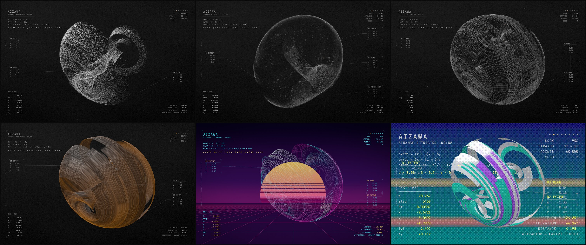
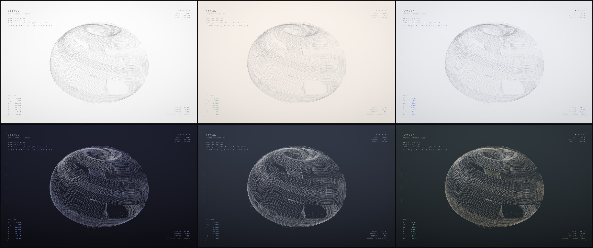

# Attractor

Strange attractors as a **live wallpaper** and a **screensaver** for [Omarchy](https://omarchy.org), by lAvArt Studio.

Hundreds of orbits are integrated through the Lorenz, Aizawa, Halvorsen, Thomas, Rössler, Chen-Lee, four-wing and
Dadras systems and drawn as what a strange attractor really is, a folded sheet: neighbouring orbits are kept side by
side in ribbons, so the picture is a fine weave of hairlines with near folds hiding far ones, not a tangle of loose
trails. A slow camera leans around its open side (never edge-on), the system's equations and live numbers sit quietly in the margins, and every few
minutes one attractor fades out and the next grows in.


## Two modes, one binary

- **Wallpaper** (`attractor --wallpaper`): a `wlr-layer-shell` surface on the *bottom* layer, above Omarchy's own
  background and below every window. Clicks pass straight through to the desktop. It renders at the panel's native
  resolution, at 30 fps (20 on battery), and **pauses itself** when it cannot be seen: a fullscreen window, a locked session, or a
  sleeping monitor.
- **Screensaver** (`attractor`): a fullscreen window using Omarchy's screensaver class, so the idle service still locks on
  time; any key, click or mouse movement dismisses it, and so does losing focus (a workspace switch), so a saver nobody can
  see never lingers. Like Gridfall it stays on the integrated GPU by default.

The plugin service starts the wallpaper at login and the screensaver after the system idle timeout
(`idle.screensaver` in `shell.json`).

## Installing

You'll need the Rust toolchain to build it once.

```bash
omarchy plugin add https://github.com/lAvArt/attractor
cargo build --release --locked --target-dir ~/.cache/attractor/build \
  --manifest-path ~/.config/omarchy/plugins/io.github.lavart.attractor/Cargo.toml
omarchy plugin enable io.github.lavart.attractor
```

Try it without the plugin: `attractor --bench 150`, `attractor --windowed`, `attractor --keep` (a screensaver that ignores input), `attractor --wallpaper`, or render a still with
`attractor --shot out.png --system lorenz --size 1920x1080 --secs 30`.

## Looks

| preset | |
|---|---|
| `theme` (default) | `stipple` for the wallpaper and `dust` for the screensaver, in the system theme's colours |
| `weave` | a wireframe of the sheet: hairlines along the flow and across it, coming apart into dust where the trails end |
| `contour` | fine parallel lines along the flow, like the contours of a relief, brightest where the sheet faces the light, with a shallow depth of field |
| `stipple` | a halftone: dots whose area is the light, each at its own fixed place so nothing beats or shimmers. Nothing is cut off behind a nearer fold: dots there thin and dim smoothly |
| `dust` | grains riding the strands like silk, crisp in the focal plane; before and behind it the brightest swell into discs of light, with a few soft lights and sparkles in the theme's accent |
| `80s` | a vector display: a hidden-line wireframe in magenta and cyan over a banded sun and a grid, scanlines, chunky text |
| `90s` | early computer graphics: flat-shaded ribbons in a coarse picture of about 400 lines (640x400 on a 3200x2000 panel) scaled up in whole pixels and dithered down to 216 colours, over copper bars |



`attractor --looks` lists them. Every look follows the system theme (dark themes get light lines on their ground, light
themes ink on paper; the shaded side of the form is a deeper tint of the same hue, never a step toward black) except
`80s` and `90s`, whose colours are the point. `"palette": "original"` gives any look the colours of the picture it is
after (mint on indigo for `contour`, silver on black for `weave`...), and `"palette": "theme"` tints the two period
looks from the theme too.



## Following the theme

The looks read the active Omarchy theme (`colors.toml`) and watch it, with a single `stat` once a second. When the theme
changes, the ground, the lines and the annotations crossfade to the new palette over a moment, in the wallpaper and the
screensaver alike, even while a fullscreen window has paused the drawing. Nothing needs restarting.

## Annotations

Around the edges, clear of the bar and the dock: the running attractor's name, its equations with the parameter values
actually used, and numbers read from the integration a few times a second: time, step count and step size, the position
and speed of one orbit in the system's own coordinates, the camera, and a running estimate of the largest Lyapunov
exponent λ₁ (Benettin's method: a second orbit a hair away from a reference one, renormalised every step; for Lorenz it
settles near the textbook 0.906). They fade with the attractor they describe and follow the theme. `"annotations": false`
turns them off. The font is the system's monospace font (`fc-match monospace`); set `ATTRACTOR_FONT` to a `.ttf` to use
another.

## Performance

Measured offscreen on an Iris Xe on mains (`attractor --bench 150 [--wallpaper] [--size WxH] [--preset NAME]`, best of
four runs), GPU milliseconds per frame at 3200x2000:

| look | wallpaper | screensaver |
|---|---|---|
| `stipple` (the wallpaper's default) | about 2.3 ms (600 strands x 300 dots) | about 2.9 ms |
| `dust` (the screensaver's default) | about 2.8 ms | about 4.3 ms (1040 strands x 336 grains) |
| `weave` | 2.4 - 2.6 ms (600 strands) | 3.7 ms (960 strands) |
| `contour` | 2.9 ms | 4.5 ms |
| `80s` | 2.8 ms | 2.9 ms |
| `90s` | 1.3 ms | 1.0 ms |

For scale: the previous renderer (256 trails) took 1.5 - 1.9 ms for its wallpaper when drawing the scene at half size and
2.0 - 2.3 ms at true native size on the same machine in the same sessions. Timings on a laptop in use vary by a third
from one minute to the next; these are the better runs. (The `stipple` and `dust` rows were measured in a slower
session, 3.5 / 4.3 ms and 4.6 / 6.8 ms against 3.9 ms for the `weave` wallpaper, and are scaled to the same footing.)

How: everything is one render pass straight into the output, with no intermediate full-size texture; lines are single
triangle strips, anti-aliased analytically instead of by multisampling; the older, fainter part of every strand is drawn
with every other point; the sheets that do the hiding are wide strips written to depth only; and nothing is drawn at all
while the wallpaper is hidden. On a weaker GPU set `"hidpi": false` (wallpaper: logical pixels, scaled by the compositor)
or a `render_scale` below 1; both soften the lines.

## Your logo

Put a mark of your own on the wallpaper and the screensaver. It sits quietly behind the trails as a hairline outline over
a faint fill, in a colour taken from the look, and the attractor slides aside to make room for it.

```json
{
  "logo": "~/Pictures/my-logo.svg",
  "logo_style": "both",
  "logo_color": "auto",
  "logo_size": 0.56,
  "logo_x": 0.66,
  "logo_y": 0.52
}
```

`logo` is the path of an SVG, or `"twinise"` / `"omarchy"` for the built-in marks (`"none"` is the default). Text in the SVG
must be converted to paths. Only the shapes and their opacity matter unless you set `"logo_color": "svg"`.

| key | default | |
|---|---|---|
| `logo_style` | `both` | `outline`, `fill` or `both` |
| `logo_color` | `auto` | `auto` (the look's own colour), `accent` or `foreground` (your theme), `svg` (the SVG's colours) or `#rrggbb` |
| `logo_size` | `0.56` | the logo's longer side, as a fraction of the screen height |
| `logo_x`, `logo_y` | `0.66`, `0.52` | the logo's centre, as fractions of the screen |
| `logo_opacity` | `0.6` | |
| `shift_x`, `shift_y` | `-0.3` with a logo, else `0` | slides the attractor sideways / up, in units of half the screen |

## Configuration

`~/.config/attractor/config.json` (the service restarts the wallpaper when it changes). Everything is optional:

```json
{
  "preset": "theme",
  "system": "cycle",
  "saver": "auto",
  "wallpaper": true,
  "annotations": true,
  "wallpaper_options": { "fps": 30, "speed": 0.7 },
  "saver_options": { "preset": "dust", "fps": 60 }
}
```

| key | default | |
|---|---|---|
| `preset` | `theme` | see Looks |
| `palette` | `auto` | `theme`, `original`, or `auto` (the theme, except for `80s` and `90s`) |
| `annotations` | `true` | the equations and live numbers in the margins |
| `system` | `cycle` | an attractor's name (`attractor --list`), or `cycle` to rotate through all |
| `cycle` | 150 / 90 | seconds on each attractor (wallpaper / screensaver) |
| `saver` | `auto` | `on`, `off`, or `auto`: on unless Gridfall is enabled, so two screensavers never race on idle |
| `wallpaper` | `true` | run the live wallpaper |
| `width` | `1` | a multiplier on the look's line and dot sizes: `0.8` is finer, `1.5` bolder. (It used to be a width in pixels; the looks' own weights are now hairlines, about one physical pixel on a 2x panel) |
| `intensity` | `1` | a multiplier on the opacity of the lines and dots |
| `trails`, `strands`, `length` | per look | how many strands in all, how many of them make a ribbon, and how many points each remembers: detail and cost |
| `hidpi` | `true` | wallpaper only: `false` renders at logical pixels and lets the compositor scale (cheaper, softer) |
| `render_scale` | `1` | draw the scene smaller and scale it up (cheaper, softer) |
| `overlay` | `false` | wallpaper only: draw over the desktop wallpaper instead of on the look's own ground |
| `fps`, `speed`, `zoom` | per mode | |
| `gpu` | `low` | `high` uses the discrete GPU; leave it on `low` on hybrid laptops |

`wallpaper_options` and `saver_options` override any of the above for that mode only. `ATTRACTOR_PRESET`,
`ATTRACTOR_PALETTE`, `ATTRACTOR_SYSTEM` and `ATTRACTOR_GPU` override the config for a single run; `ATTRACTOR_THEME` points
at a `colors.toml` other than the active theme's. The old `bloom` key and the old preset names are ignored (an unknown
preset draws the default look).

## How it works

Each attractor is integrated on the CPU in f64 with RK4 and fitted automatically to the screen (centre, radius and step
size are measured from a warm-up orbit, so there are no hand-tuned scales).

**Ribbons.** Strands are grouped into ribbons of neighbours that start a hair apart along a short curve. Chaos would
pull them apart exponentially; instead each ribbon is held to a constant width the way a Lyapunov vector is
renormalised: every step its strands are slid a little along the curve they form, toward the middle and toward their
own places on it, and slid along their own orbits so the ribbon's leading edge stays square to the flow. The ribbon
therefore lies along the attractor's stretching direction and sweeps out a band of the folded sheet, and strand k stays
next to strand k+1, which is what lets a surface, cross-lines and a hiding sheet be drawn between them. Where the flow
tears a ribbon in two (the Lorenz saddle sends one half to each wing) the smaller half thins away and grows again beside
the half that stayed. The cost of this is honesty of a specific kind: the strands are orbits that are nudged sideways by
a fraction of a step each step, so they trace the sheet faithfully but are not, point for point, solutions of the
equations. They also run on a rescaled clock (slowed where the flow is fast, hurried where it is slow) so that steps are
nearly equal in length and fast loops are not drawn with a few straight pieces. The numbers in the margins come from a
separate, untouched orbit on the true clock.

**Framing.** The direction in which an orbit varies least is the one to look along: seen that way the form is open,
seen across it it would be edge-on. The camera circles that face-on view at a lean of 17 to 45 degrees, slowly (fine
dots that slide more than a fraction of a pixel per frame shimmer). The scale is fitted by projecting the form through
that same camera path, so its body stands within 80% of the screen's height and 68% of its width at its most awkward,
and the margins stay free for the annotations.

**Drawing.** Every strand keeps a ring of its latest points; each frame only the newly computed points are uploaded to
a GPU storage buffer. The vertex shader reads that ring and widens every point of a strand into one continuous triangle
strip with a shared tangent at each point, so there are no joints to gap, overlap or bead. The fragment shader computes
exact coverage (a pixel-wide box against the line), so a hairline thinner than a pixel dims instead of breaking into
dots, and depth of field is the same formula with a wider box: nothing is multisampled and nothing is blurred
afterwards. Strips between neighbouring strands are written to the depth buffer so near folds hide far ones; far
strands sink toward the ground colour. Strand spacing is deliberately uneven and dots sit at fixed, hashed offsets, so
regular marks never beat against the pixel grid. Wherever points are thinned (every other point of an old line, the
strips of a sheet) they are chosen by their slot in the ring, not by their age, so the same points are drawn every
frame and nothing swaps as the head moves on; new dots swell in over a second. In the dot looks a nearer sheet does not
cut off what is behind it: its depth and strength are drawn into a small texture that every dot reads, and a covered
dot thins and dims in proportion.

`attractor --flicker 60 --hold --wallpaper --preset stipple` measures this: it renders consecutive frames at the real
pacing with the camera held still, when nothing but growing heads and fading tails should change, and reports how many
pixels jump. `attractor --dark-check` counts pixels where the form made a dark ground darker (or a light one lighter).

Remote control: `omarchy-shell attractor preview` starts the screensaver now, `omarchy-shell attractor status` reports
the state, `omarchy-shell attractor restart` restarts the wallpaper.

MIT licensed.
